# Courier — architecture diagrams and flows

Every diagram and every pseudocode block here was derived from the code on `main` as of commit
`5cbf396` (October 2026), not from the earlier specs. Pseudocode uses the real class and method
names, so you can search for any line and land on the code that does it. Where something exists as a
library but nothing in the app or CLI calls it yet, the flow says so.

Companion to [ARCHITECTURE.md](ARCHITECTURE.md), which explains *why* the designs are what they
are. This document shows *how the pieces move*.

Diagrams are [Mermaid](https://mermaid.js.org/). They render on GitHub, in VS Code's Markdown
preview, and in `ARCHITECTURE_DIAGRAMS.html` next to this file.

---

## 1. System context

Courier runs entirely on the developer's machine. It has three entry points: the desktop app, the
`courier` CLI, and an MSBuild task that shells out to the CLI. Every outbound connection, whichever
entry point started it, goes through one chokepoint: `EgressGate`.

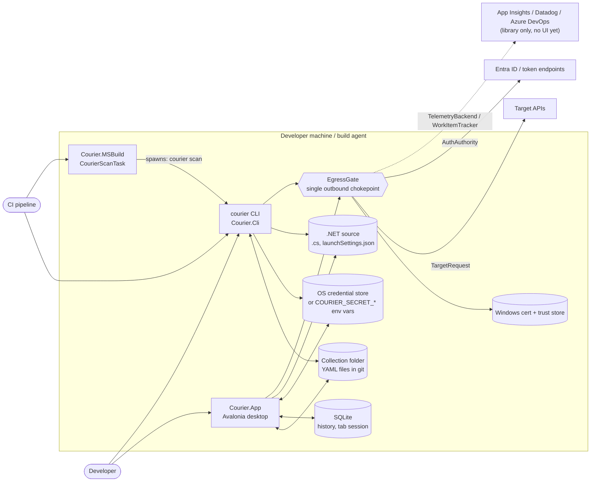

**Rules visible in this picture**

- No server is operated by the project. Nothing in startup contacts the network: there is no update
  check, no analytics and no crash reporter.
- Credentials never land in the collection folder. Their *names* are written there; their *values*
  live in the OS credential store (desktop) or in `COURIER_SECRET_*` environment variables (CLI).
- The MSBuild task can't load the `net10.0` scanner, because MSBuild may be .NET Framework. It runs
  `courier scan` as a separate process and reads the JSON report it writes.

---

## 2. Projects and layers

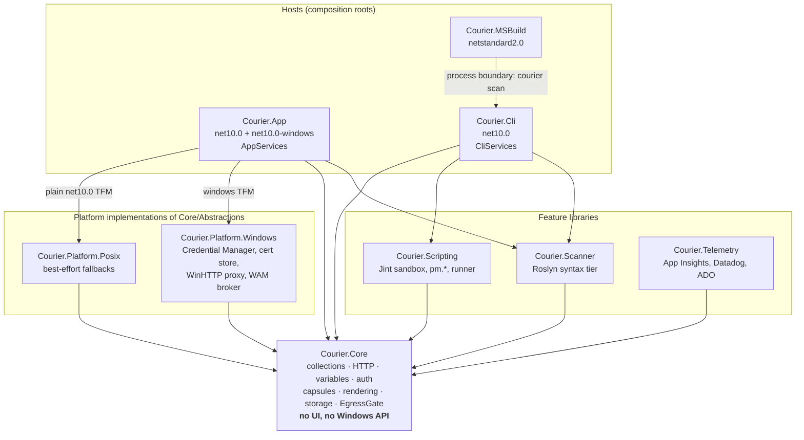

**The abstractions in `Core/Abstractions`**: `ISecretStore`, `ITrustStore`, `ICertificateSource`,
`IProxyResolver`, `IIntegratedAuthProvider`, `IGitStatusSource`, `IFileRevealer`.

| Host | Secret store | Proxy | Trust | Why |
|---|---|---|---|---|
| App on Windows | `WindowsSecretStore` (Credential Manager) | `WinHttpProxyResolver` (PAC) | `WindowsTrustStore` | Full enterprise path |
| App elsewhere | Posix fallbacks | Posix fallbacks | Posix fallbacks | Linux/macOS contributors can still build and run it |
| CLI (any OS) | `EnvironmentSecretStore` (read-only, `COURIER_SECRET_*`) | `EnvironmentProxyResolver` | `FallbackTrustStore` | A build agent has no interactive session to unlock a vault. The CLI fails clearly instead of hanging |

`ArchitectureTests` enforces the Core rule. It fails the build if `Courier.Core` gains an Avalonia
reference, a `net*-windows` target or a `Microsoft.Win32` using.

---

## 3. Data model at a glance

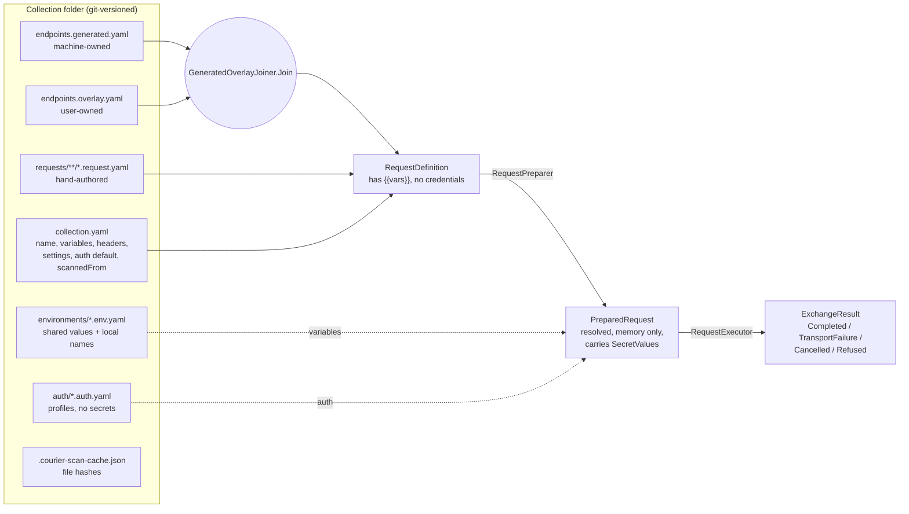

The definition (what you edit and what goes to disk) and the prepared request (resolved, credentials
included, memory only) are deliberately separate types.

---

## F1. App startup and deferred jobs

The first frame has a time budget (PERF-01), so the constructor graph is kept shallow and
everything that isn't needed to draw it is queued until after the first paint.

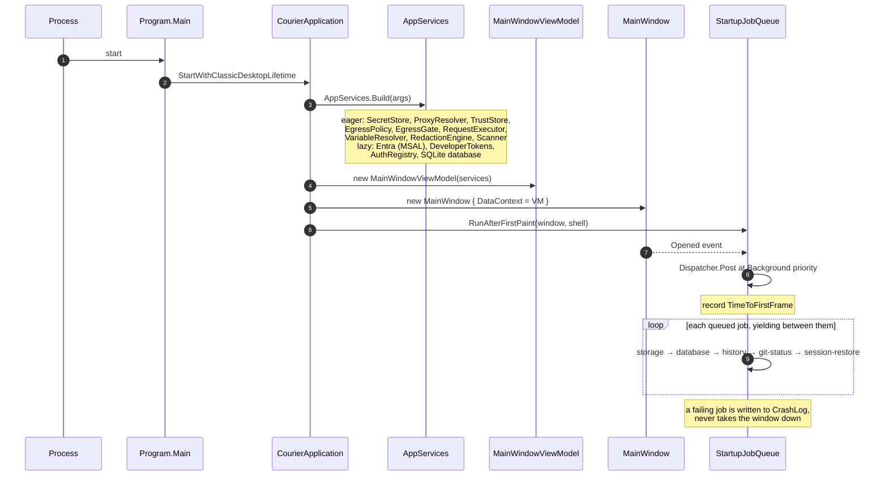

**Pseudocode**

```text
Program.Main(args):
    try   BuildAvaloniaApp().StartWithClassicDesktopLifetime(args)
    catch ex → CrashLog.Write(ex); return 1          // local log only, nothing is sent

CourierApplication.OnFrameworkInitializationCompleted():
    services ← AppServices.Build(args)               // cheap objects only
    shell    ← new MainWindowViewModel(services)
    window   ← new MainWindow(DataContext = shell)
    on ShutdownRequested → services.Dispose()
    services.StartupJobs.RunAfterFirstPaint(window, shell)

StartupJobQueue.RunAfterFirstPaint(window, shell):
    enqueue "storage"         → StorageLocations.EnsureCreated()
    enqueue "database"        → services.DatabaseAsync()        // opens + migrates SQLite
    enqueue "history"         → shell.LoadHistoryAsync()
    enqueue "git-status"      → shell.RefreshGitStatusAsync()   // shells out to git
    enqueue "session-restore" → shell.RestoreSessionAsync()
    on window.Opened (once):
        post at Background priority:
            TimeToFirstFrame ← now − process start
            ReportStartup()            // only if COURIER_STARTUP_REPORT is set (perf gate)
            for job in queue:
                try await job() catch ex → CrashLog.Write(ex)
                yield to UI thread
```

**Key files**: `App/Program.cs`, `App/App.axaml.cs`, `App/Services/AppServices.cs`,
`App/Services/StartupJobQueue.cs`

---

## F2. Open or create a collection folder

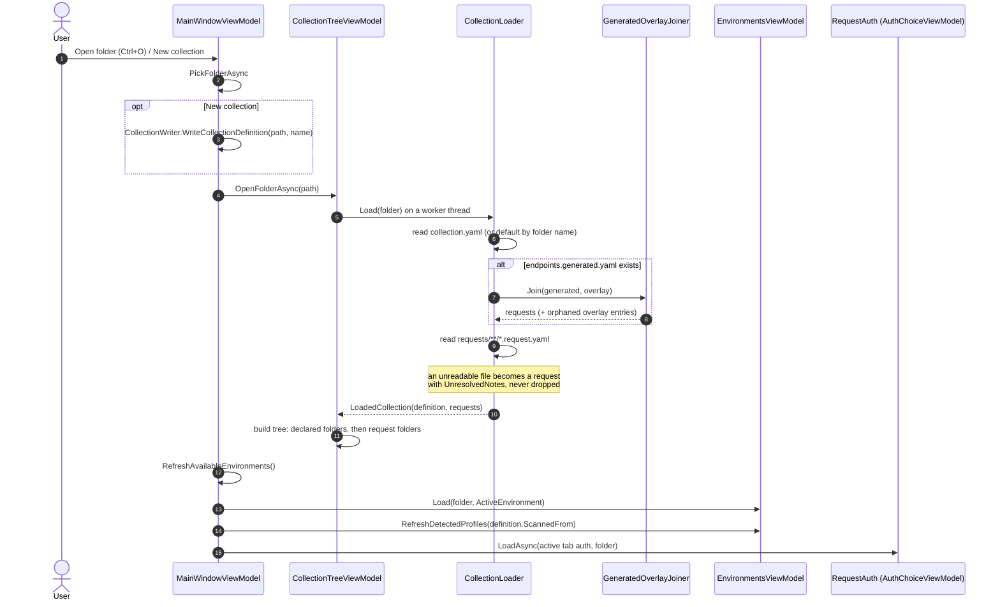

**Pseudocode**

```text
OpenAndPrimeFolderAsync(path):
    Tree.OpenFolderAsync(path):
        loaded ← Task.Run(CollectionLoader.Load(path))
        Definition ← loaded.Definition
        root ← node(CollectionName)
        for f in Definition.Folders: root.EnsureFolder(f)        // empty folders still show
        for group in loaded.Requests grouped by Folder:
            add a request node under root.EnsureFolder(group)
    RefreshAvailableEnvironments()                               // title-bar picker
    Environments.Load(folder, ActiveEnvironment)
    Environments.RefreshDetectedProfiles(Definition.ScannedFrom?.Path)
    RequestAuth.LoadAsync(activeTab.Auth, folder)

CollectionLoader.Load(folder):
    definition ← exists(collection.yaml) ? deserialize : { Name = folder name }
    requests ← []
    if exists(endpoints.generated.yaml):
        overlay ← exists(endpoints.overlay.yaml) ? deserialize : empty
        requests += GeneratedOverlayJoiner.Join(generated, overlay)
    for file in requests/**/*.request.yaml (ordinal order):
        try   r ← deserialize(file); r.Folder ??= relative dir; requests += r
        catch CollectionFormatException → requests += placeholder with UnresolvedNotes
    return (definition, requests)

NewCollectionAsync():
    path ← PickFolderAsync()
    CollectionWriter.WriteCollectionDefinition(path, name)        // no-op if it already exists
    OpenAndPrimeFolderAsync(path)
```

**Key files**: `App/ViewModels/MainWindowViewModel.cs`, `App/ViewModels/CollectionTreeViewModel.cs`,
`Core/Collections/CollectionLoader.cs`, `Core/Collections/GeneratedOverlay.cs`

---

## F3. Send a request (desktop app)

This is the central flow. The CLI's `courier run` (F13) goes through the same `RequestPreparer`
and `RequestExecutor`, so the two can't drift apart.

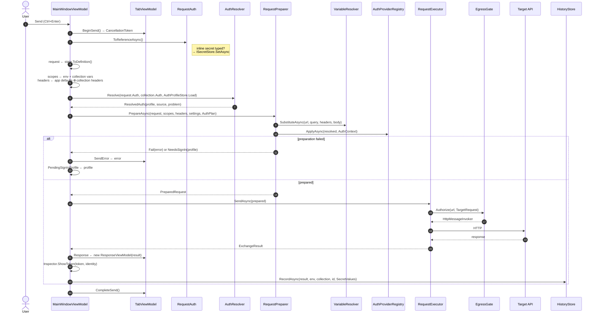

**Pseudocode**

```text
MainWindowViewModel.SendAsync():
    tab ← Tabs.Active;  if none → return
    tab.SendError ← null
    ct  ← tab.BeginSend()
    try:
        state.Auth ← await RequestAuth.ToReferenceAsync(ct)    // commit Auth panel first
        request    ← state.ToDefinition()
        scopes     ← VariableScopes { Environment = ActiveEnvironment,
                                      Collection  = Tree.Definition.Variables }
        inherited  ← _defaultHeaders (app settings: Accept, User-Agent, …) ⊕ Tree.Definition.Headers  // later wins
        resolved   ← AuthResolver.Resolve(request.Auth, Tree.Definition.Auth,
                                          name → AuthProfileStore.Load(Tree.Folder, name))
        prep ← await RequestPreparer.PrepareAsync(request, scopes, Variables, inherited,
                    Tree.Definition.Settings, Tree.Definition.InjectTraceParent,
                    EnvironmentName, AuthPlan(resolved, AuthRegistry), ct)
        if not prep.Succeeded:
            tab.SendError        ← prep.Error           // plain English, names the cause
            PendingSignInProfile ← prep.SignInProfile   // shows a "Sign in" button if set
            return
        result ← await Executor.SendAsync(prep.Request, ct)
        tab.Response?.Dispose();  tab.Response ← new ResponseViewModel(result)
        Inspector.ShowToken(prep.Request.Auth?.Token, identity)
        await HistoryStore.RecordAsync(result, EnvironmentName, CollectionName,
                                       state.EndpointId ?? state.RequestPath,
                                       prep.Request.SecretValues, ct)
        HistoryCount++
    catch OperationCanceledException → (normal; nothing to report)
    finally tab.CompleteSend()

SignInAndRetryAsync():                                   // only after the user clicks "Sign in"
    await Entra.AcquireAsync(_lastAuthProfile, interactiveAllowed = true)
    on InteractiveAuthRequiredException → tab.SendError ← message; return
    await SendAsync()
```

**Key files**: `App/ViewModels/MainWindowViewModel.cs` (`SendAsync`, `SignInAndRetryAsync`),
`Core/Http/RequestPreparer.cs`, `Core/Http/RequestExecutor.cs`, `Core/Storage/HistoryStore.cs`

### F3a. Request preparation and variable resolution

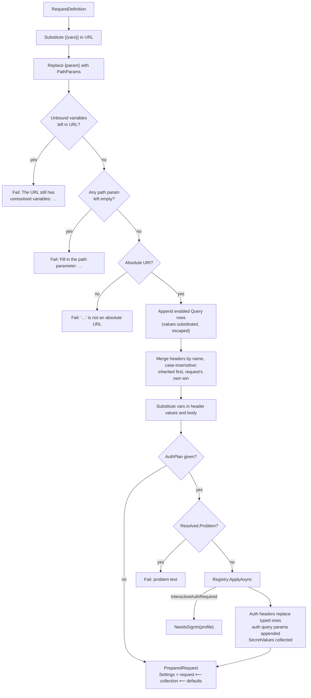

Variables are resolved in **request → environment (shared, then local from the secret store) →
collection → global** order. A value that itself contains `{{…}}` is resolved again, up to 10 levels
deep.

```text
VariableResolver.ResolveAsync(name, scopes):
    if scopes.Request has name           → (value, Request)
    if scopes.Environment:
        if Environment.Shared has name   → (value, EnvironmentShared)
        if Environment.LocalNames has name:
            secret ← ISecretStore.GetAsync(Environment.SecretKeyFor(name))
            return secret ? (secret, EnvironmentLocal, IsSecret = true) : Missing
    if scopes.Collection has name        → (value, Collection)
    if scopes.Global has name            → (value, Global)
    return Missing

VariableResolver.SubstituteAsync(text, scopes):
    repeat up to 10 times:
        refs ← regex \{\{ name \}\} over current text
        if no refs → stop
        for each ref: resolved ? splice value : leave "{{name}}" in place, add to Unbound
        if nothing was substituted this pass → stop
    return (text, used, unbound)

RequestPreparer.PrepareAsync(request, scopes, variables, inherited, settings, trace, env, auth):
    url ← Substitute(request.Url); replace each {name} from request.PathParams
    if url.Unbound          → Fail("The URL still has unresolved variables: …")
    if any empty path param → Fail("Fill in the path parameter(s): …")
    if url not absolute     → Fail("'…' is not an absolute URL.")
    append enabled query rows (substituted, URI-escaped)
    headers ← inherited overlaid by request.Headers (enabled, named), values substituted
    body    ← UTF-8 of Substitute(request.Body.Text)
    if auth:
        if auth.Resolved.Problem → Fail(problem)
        if auth.Resolved.HasAuth:
            try   r ← auth.Registry.ApplyAsync(resolved, AuthContext(uri, method, body))
            catch InteractiveAuthRequiredException e → NeedsSignIn(e.ProfileName, e.Message)
            for h in r.Headers: remove same-named header; add h     // Auth tab wins
            query += r.QueryParameters;  secrets += r.SecretValues()
    return Ok(PreparedRequest{ method, uri, headers, body, contentType,
                               Settings = request.Settings ⟵ collection ⟵ Defaults,
                               env, trace, Auth = r, SecretValues = secrets })
```

**Key files**: `Core/Http/RequestPreparer.cs`, `Core/Variables/VariableResolver.cs`

### F3b. Auth resolution and application

Auth can be set in three places: the request itself, the collection default in `collection.yaml`,
or a saved profile under `auth/`. A request defaults to **Inherit**.

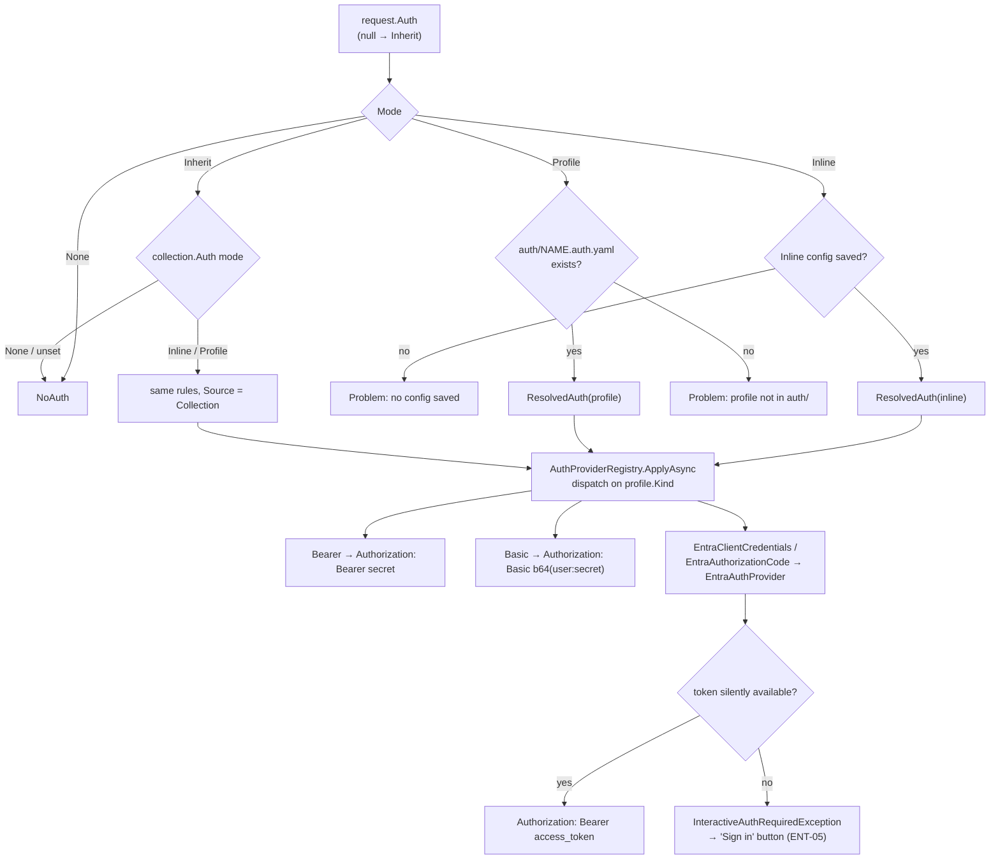

The registry in both `AppServices` and `CliServices` maps **Bearer, Basic,
EntraClientCredentials, EntraAuthorizationCode**. `SimpleAuthProviders.cs` also defines providers
for ApiKey, AWS SigV4 and Integrated Windows auth, but neither registry wires them in yet, so
`ApplyAsync` throws `NotSupportedException` for those kinds.

```text
AuthResolver.Resolve(requestAuth, collectionAuth, lookup):
    req ← requestAuth ?? Inherit
    if req.Mode ≠ Inherit → ResolveReference(req, Source = Request)
    col ← collectionAuth ?? None
    return col.Mode = None ? NoAuth : ResolveReference(col, Source = Collection)

ResolveReference(ref, source):
    None    → NoAuth
    Inline  → ref.Inline ? Resolved(ref.Inline) : Problem("…none was saved with it.")
    Profile → name empty ? Problem
              : lookup(name) ?? Problem("Auth profile 'X' is not in auth/…")

AuthProviderRegistry.ApplyAsync(resolved, ctx):
    if not resolved.HasAuth → AuthResult.None
    provider ← map[profile.Kind] or throw NotSupported
    return provider.ApplyAsync(profile, ctx)

EntraAuthProvider.AcquireAsync(profile, interactiveAllowed):
    register authority host with EgressPolicy (AuthAuthority)
    scopes ← profile.Scopes or ["{clientId}/.default"]
    lock:
        ClientCredentials → secret ← ISecretStore.Get(profile.SecretKey)
                             (missing → InteractiveAuthRequired "No client secret is stored…")
                             MSAL confidential app (cached per secret fingerprint)
                             AcquireTokenForClient(scopes)
        DeviceCode        → DeviceCodeAsync (raises DeviceCodeIssued)
        otherwise         → silent first (cache / WAM broker);
                             prompt only if interactiveAllowed, else throw InteractiveAuthRequired
    // MSAL's HttpClient comes from EgressGate.CreateClient, so token calls are recorded too

AuthChoiceViewModel.GetTokenAsync():          // "Get token" button, inline Entra config
    store any typed secret → ISecretStore
    acquired ← Entra.AcquireAsync(profile, interactiveAllowed = true)
    Show(TokenDecoder.TryDecode(acquired.AccessToken))      // claims table in the panel
    on any failure → TokenStatusMessage + TokenAcquireFailed event
                    → MainWindowViewModel.AuthTokenError → AuthTokenErrorView popup

SaveCollectionAuthAsync():                    // "save as collection default"
    definition.Auth ← CollectionAuth.ToReferenceAsync()
    CollectionLoader.SaveCollectionDefinition(folder, definition)
```

**Key files**: `Core/Auth/AuthResolver.cs`, `Core/Auth/AuthProviderRegistry.cs`,
`Core/Auth/SimpleAuthProviders.cs`, `Core/Auth/EntraAuthProvider.cs`, `Core/Auth/TokenDecoder.cs`,
`Core/Auth/AuthProfileStore.cs`, `App/ViewModels/AuthChoiceViewModel.cs`

### F3c. Execution, redirects, retries, outcomes

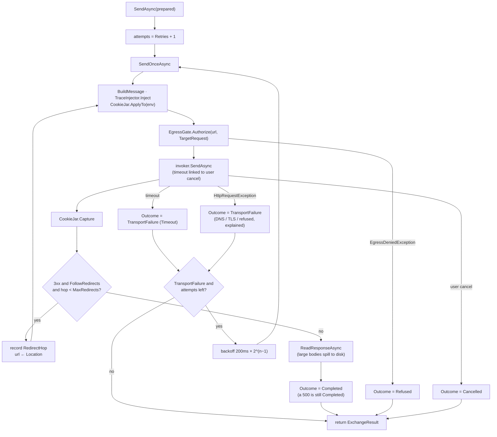

```text
RequestExecutor.SendAsync(prepared, ct):
    settings ← prepared.Settings ⟵ Defaults
    for attempt in 1..(Retries + 1):
        last ← SendOnceAsync(prepared, settings, attempt)
        if last.Outcome ≠ TransportFailure or attempt is the last → return last
        await delay(200ms × 2^(attempt−1))          // only transport failures are retried

SendOnceAsync(prepared, settings, attempt):
    url ← prepared.Url;  maxRedirects ← FollowRedirects ? (MaxRedirects ?? 10) : 0
    timeout ← TimeoutMilliseconds ?? 30 000, linked with ct
    loop hop:
        message ← BuildMessage(prepared, url)
        traceId ← TraceInjector.Inject(message, prepared.InjectTraceParent)
        CookieJar.ApplyTo(message, env)
        try:
            invoker  ← EgressGate.Authorize(url, TargetRequest, initiator, HandlerProfile)
            response ← invoker.SendAsync(message)
            CookieJar.Capture(response, env)
            if hop < maxRedirects and redirect → record hop; url ← next; continue
            return Completed(request, ReadResponseAsync(response), elapsed, traceId, redirects)
        catch EgressDenied          → Refused
        catch timeout               → TransportFailure(Timeout, "No response within … ms")
        catch OperationCanceled     → Cancelled
        catch HttpRequestException  → TransportFailure(Explain(ex, url))
```

`TransportFailure` ("the request never left or never came back") is never merged with an HTTP 500.
The UI gives it its own glyph and status text.

**Key files**: `Core/Http/RequestExecutor.cs`, `Core/Http/ExchangeResult.cs`, `Core/Http/CookieJar.cs`,
`Core/Http/TraceInjector.cs`

---

## F4. Egress chokepoint

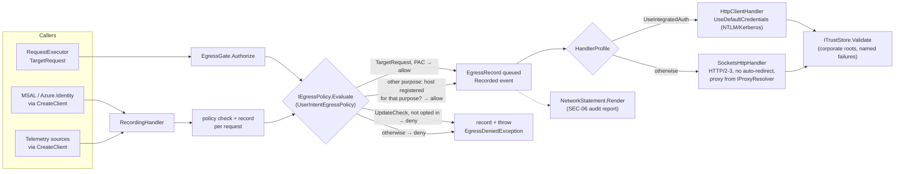

```text
EgressGate.Authorize(destination, purpose, initiator, profile):
    verdict ← policy.Evaluate(destination, purpose)
    record  ← EgressRecord(host, port, scheme, purpose, initiator, now, verdict)
    _records.Enqueue(record);  raise Recorded(record)
    if not verdict.IsAllowed → throw EgressDeniedException(reason)
    return cached HttpMessageInvoker for HandlerFor(profile)

UserIntentEgressPolicy.Evaluate(destination, purpose):
    if purpose = UpdateCheck and not opted in → Deny("Update checking is off…")
    if purpose ∈ {TargetRequest, ProxyAutoConfig} → Allow      // the URL is the user's intent
    if Registered[destination.Host] = purpose → Allow          // e.g. an auth authority
    → Deny("No configuration in this profile names HOST as a …")

EgressGate.Build(profile):                                     // cached per HandlerProfile
    if profile.UseIntegratedAuth → HttpClientHandler(UseDefaultCredentials, client certs,
                                                     proxy, trust-store validation)
    else → SocketsHttpHandler(AllowAutoRedirect = false, proxy = IProxyResolver result,
                              client certs, trust-store validation)
```

`ArchitectureTests` fails the build if any other code constructs a handler or socket, so the network
statement can't under-report what the process does.

**Key files**: `Core/Privacy/EgressGate.cs`, `Core/Privacy/IEgressPolicy.cs`,
`Core/Privacy/EgressPurpose.cs`, `Core/Privacy/NetworkStatement.cs`

---

## F5. Response rendering

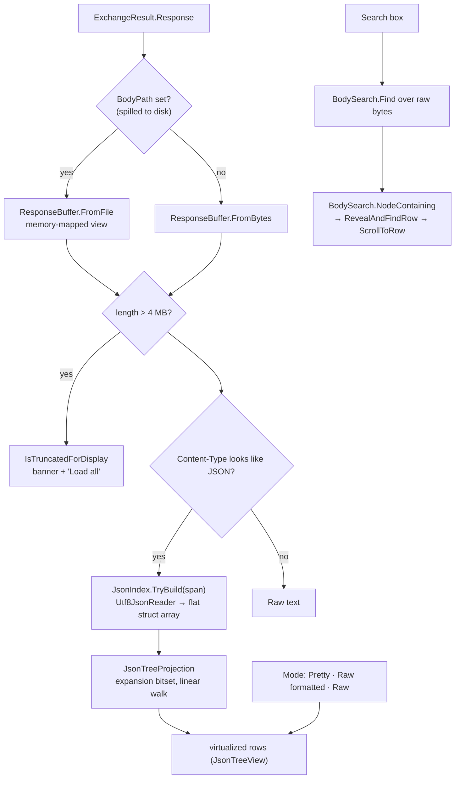

```text
ResponseViewModel(result).Load():
    RequestHeaders  ← result.Request.Headers as rows
    if no response → return                        // transport failure: status text explains
    ResponseHeaders ← response.Headers as rows
    buffer ← response.BodyPath ? ResponseBuffer.FromFile(path) : FromBytes(body)
    IsTruncatedForDisplay ← buffer.Length > 4 MB
    if LooksLikeJson(contentType):
        Index ← JsonIndex.TryBuild(first 4 MB span)
        Tree  ← new JsonTreeProjection(Index)

Search(term):  Matches ← BodySearch.Find(span, term)        // never walks the tree
MoveToMatch(i): node ← BodySearch.NodeContaining(Index, offset[i])
                row  ← Tree.RevealAndFindRow(node); ScrollToRow(row)
Mode = RawFormatted → JsonSerializer re-indent (cached; falls back to raw if cut mid-token)
LoadEverything()    → rebuild Index/Tree over the whole buffer
Release()           → drop buffer + index (called when the tab suspends or closes)
```

**Key files**: `App/ViewModels/ResponseViewModel.cs`, `Core/Rendering/ResponseBuffer.cs`,
`Core/Rendering/JsonIndex.cs`, `Core/Rendering/JsonTreeProjection.cs`, `Core/Rendering/BodySearch.cs`

---

## F6. Save, Save all, and the close-tab guard

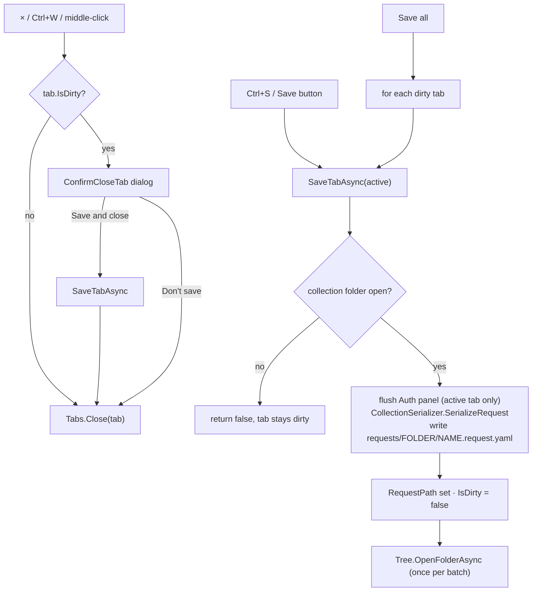

```text
SaveTabAsync(tab):
    if no state or Tree.Folder is null → return false
    if tab is active → state.Auth ← RequestAuth.ToReferenceAsync()
            // other tabs already flushed their auth when the user switched away
    yaml ← new CollectionSerializer().SerializeRequest(state.ToDefinition())
    path ← state.RequestPath
           ?? Tree.Folder/requests/{state.Folder}/{CollectionFormat.FileNameFor(def)}
    create the directory; write yaml
    state.RequestPath ← path;  state.IsDirty ← tab.IsDirty ← false
    return true

SaveAllAsync():
    dirty ← tabs where IsDirty;  if none → "Nothing to save"
    saved ← count of SaveTabAsync(t) = true
    if saved > 0 → Tree.OpenFolderAsync(Folder)          // once for the whole batch
    status ← "Saved N requests" or "Saved N of M — open a collection folder to save the rest"

RequestCloseTab(tab):
    if not tab.IsDirty → Tabs.Close(tab)
    else PendingCloseTab ← tab; Dialog ← ConfirmCloseTab
```

**Key files**: `App/ViewModels/MainWindowViewModel.cs` (`SaveTabAsync`, `SaveAllAsync`,
`RequestCloseTab`, `ConfirmCloseTab*`), `Core/Collections/CollectionSerializer.cs`

---

## F7. Tab lifecycle and suspension

A tab is a serializable POCO (`TabState`), never a live control tree. Only 8 tabs stay live; the
rest are serialized to a compact JSON string held **in memory**, and their response buffers are
released. The whole session goes to SQLite when the window closes, and comes back after the
next launch's first paint.

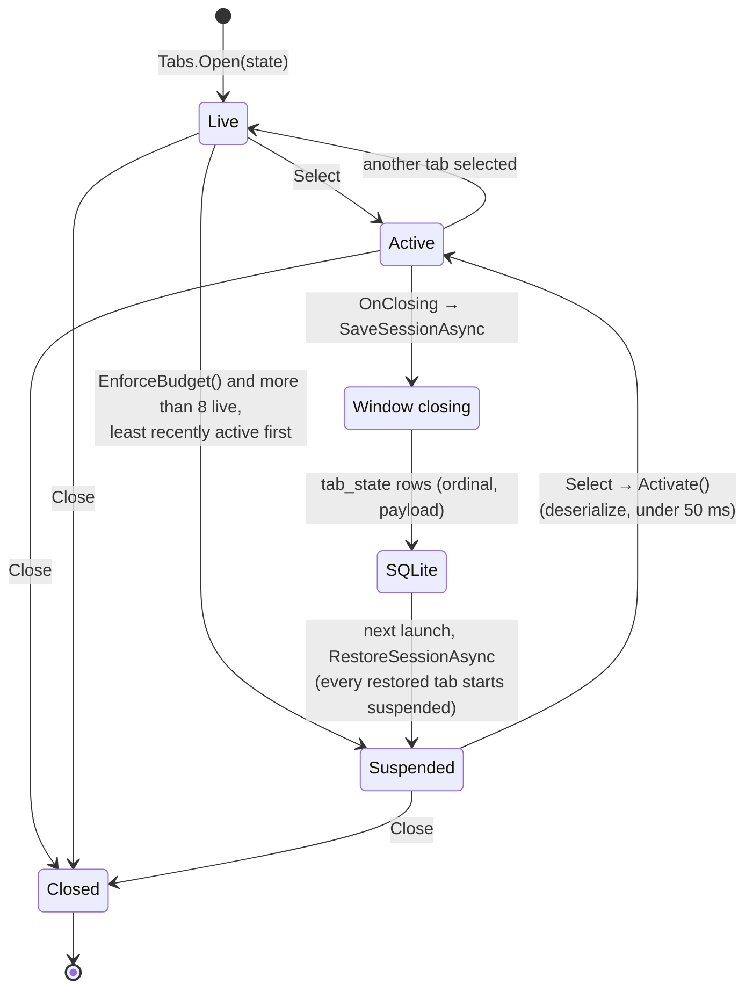

```text
TabCollection.Select(tab):
    previous.IsActive ← false;  Active ← tab
    tab.Activate()                 // rehydrate from _suspendedPayload if suspended
    EnforceBudget()

EnforceBudget():
    if Items.Count ≤ LiveTabBudget(8) → return
    live ← non-suspended tabs ordered by LastActive desc
    for tab in live.Skip(8): if tab ≠ Active → tab.Suspend()

TabViewModel.Suspend():
    _suspendedPayload ← JsonSerializer.Serialize(State);  State ← null
    Response.Release();  Response ← null      // drops the large buffer + index
    // Title, Method and VerbBrush stay resident, so the strip looks identical

SaveSessionAsync():   DELETE tab_state; INSERT one row per tab (ordinal, payload)
RestoreSessionAsync(): read payloads in order → TabViewModel.Deserialize → Suspend()
                       replace the placeholder tab only if something was restored
                       (SQLite errors → CrashLog, empty session)
```

**Key files**: `App/ViewModels/TabCollection.cs`, `App/ViewModels/TabViewModel.cs`,
`App/ViewModels/TabState.cs`, `App/Views/MainWindow.axaml.cs`, `Core/Storage/CourierDatabase.cs`

---

## F8. Import from code: scan → diff → apply

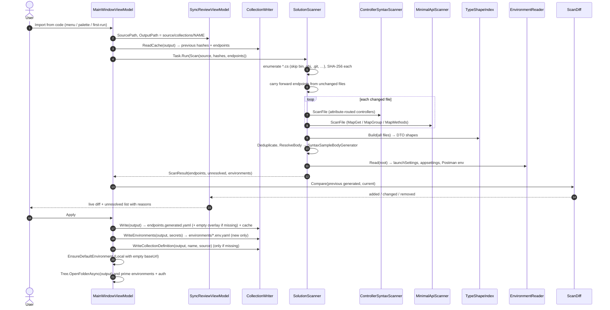

```text
RunScanAsync():
    cache   ← CollectionWriter.ReadCache(OutputPath)               // null on first scan
    result  ← await Task.Run(Scanner.Scan(SourcePath, cache?.Hashes, cache?.Endpoints))
    current ← result.Endpoints.map(e → e.ToRequest("baseUrl"))
    changes ← ScanDiff.Compare(LoadPreviousGenerated(OutputPath), current)
    SyncReview.Load(changes, result, collectionName)

SolutionScanner.Scan(path, previousHashes, previousEndpoints):
    files  ← *.cs under ResolveRoot(path), excluding bin/obj/node_modules/.git/…
    hashes ← SHA-256 per file
    if incremental: endpoints ← previous endpoints from unchanged files; toParse ← changed
    for file in toParse:
        text ← read (IOException → Unresolved "could not be read")
        for r in ControllerSyntaxScanner.ScanFile ∪ MinimalApiScanner.ScanFile:
            ScannedEndpoint → endpoints;  UnresolvedEndpoint → unresolved
    shapes ← TypeShapeIndex.Build(all files)      // DTOs often live in another file
    return ScanResult{ Deduplicate(endpoints).map(ResolveBody(·, shapes)), unresolved,
                       EnvironmentReader.Read(root), Tier = Syntax, hashes, elapsed }

ControllerSyntaxScanner.ScanController(class):
    prefix ← [Route] on the class; version ← ApiVersionReader; auth ← [Authorize]/[AllowAnonymous]
    for public method with Http* verbs:
        for each verb attribute:
            template not a literal → Unresolved("…not a literal. Load the solution…")
            template ← RouteResolver.Combine(prefix, action, controller, action, version)
            empty and no [Route] → Unresolved("depends on conventional routing")
            params ← SyntaxHelpers.ReadParameters (path/query/[FromBody] type)
            emit ScannedEndpoint(EndpointIdentity.Compute(verb, template, declaringType), …)

ResolveBody(endpoint, shapes):
    if endpoint.BodyTypeName and SyntaxSampleBodyGenerator.Generate(shapes, type, namespace)
        → endpoint with SampleBody (honours [Required], [Range], [StringLength], enums,
          [JsonPropertyName])
    else → add note "Load the solution to generate a sample body…"   // reported, not guessed

ApplyScanAsync():
    CollectionWriter.Write(output, result, "baseUrl")    // generated file only; overlay untouched
    CollectionWriter.WriteEnvironments(output, result, SecretStore)   // skips existing files;
                                                                      // secrets → vault, names → file
    CollectionWriter.WriteCollectionDefinition(output, name, SourcePath)   // skips if exists
    EnsureDefaultEnvironment(output)
    open the folder in the tree; prime Environments and RequestAuth
```

**What a scan never does**: it never drops an endpoint without saying why, and it never writes
`endpoints.overlay.yaml`, an existing `*.env.yaml`, or an existing `collection.yaml`.

**Key files**: `App/ViewModels/MainWindowViewModel.cs` (`ImportFromCodeAsync`, `RunScanAsync`,
`ApplyScanAsync`), `App/ViewModels/SyncReviewViewModel.cs`, `Scanner/SolutionScanner.cs`,
`Scanner/Syntax/*`, `Scanner/Routing/*`, `Scanner/EnvironmentReader.cs`, `Scanner/Diffing/ScanDiff.cs`,
`Scanner/CollectionWriter.cs`

---

## F9. Generated / overlay layering

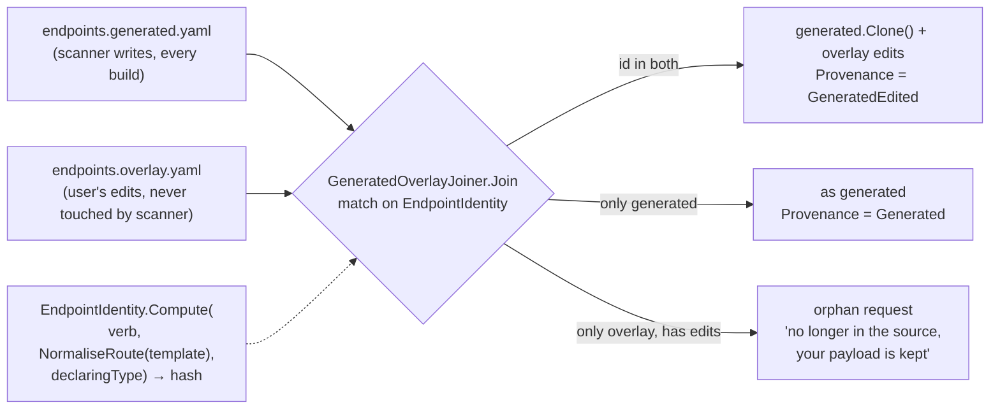

```text
EndpointIdentity.Compute(verb, routeTemplate, declaringType):
    hash( upper(verb), NormaliseRoute(template) /* constraints and defaults stripped */, type )
    // method name and body are NOT inputs, so renaming a C# method keeps the identity

GeneratedOverlayJoiner.Join(generated, overlay):
    byId ← overlay entries by Id
    for e in generated:
        if byId has e.Id → Apply(e, edits)     // name, url, body, path params, query,
                                                // headers (by name), auth, scripts,
                                                // assertions, settings (inherit)
        else             → e
    for orphan in overlay entries not matched and HasEdits:
        → request with UnresolvedNotes "This endpoint is no longer in the source…"
```

Changing what goes into `EndpointIdentity` orphans every overlay that already exists, so treat it as a
file format change (see `COLLECTION_FORMAT.md` §4).

**Key files**: `Core/Collections/EndpointIdentity.cs`, `Core/Collections/GeneratedOverlay.cs`

---

## F10. Environments and secrets

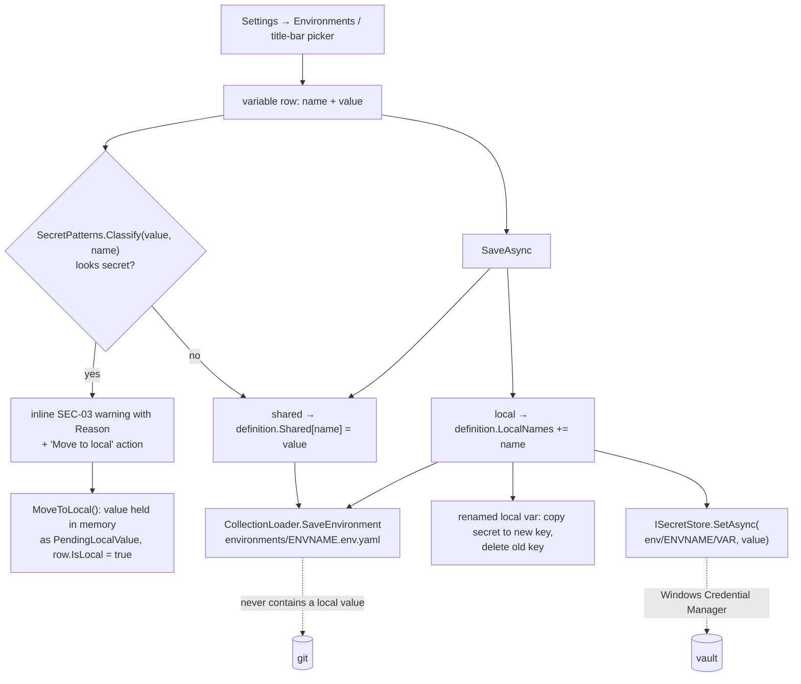

```text
EnvironmentsViewModel.SaveAsync():
    require Name
    definition ← { Name }
    for row in Variables with a name:
        if not row.IsLocal: definition.Shared[row.Name] ← row.SharedValue
        else:
            definition.LocalNames += row.Name
            if row.PendingLocalValue → SecretStore.Set(env/{Name}/{row.Name}, value)
            elif renamed            → move secret from old key to new key
    CollectionLoader.SaveEnvironment(folder, definition)
    SaveStatus ← what happened, or why it didn't        // mirrored to the status bar

At send time: VariableResolver reads Shared directly, and LocalNames via
ISecretStore.GetAsync(Environment.SecretKeyFor(name)).
```

Renaming or deleting a whole environment isn't supported yet: the secret keys embed the environment
name, and the migration that would move them hasn't been built.

**Key files**: `App/ViewModels/SettingsViewModels.cs` (`EnvironmentsViewModel`),
`Core/Collections/EnvironmentDefinition.cs`, `Core/Collections/CollectionLoader.cs`,
`Core/Privacy/SecretPatterns.cs`, `Platform.Windows/Secrets/WindowsSecretStore.cs`

---

## F11. curl import and export

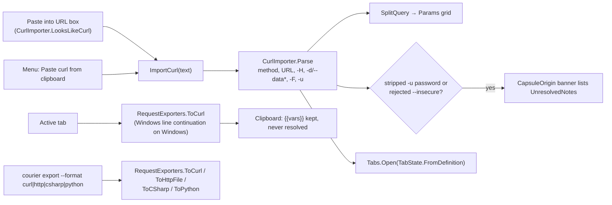

```text
ImportCurl(command):
    request ← CurlImporter.Parse(command)     // split query string; detect body kind;
                                              // drop -u password and --insecure, with a note
    state ← TabState.FromDefinition(request, CollectionName, EnvironmentName)
    if request.UnresolvedNotes → state.Capsule ← CapsuleOrigin("pasted curl", notes)
    Tabs.Open(state)

CopyAsCurlAsync():
    curl ← RequestExporters.ToCurl(activeState.ToDefinition(), windowsLineContinuation)
    clipboard.SetText(curl)                   // {{name}} references are left for the recipient
```

**Key files**: `Core/Import/CurlImporter.cs`, `Core/Export/RequestExporters.cs`,
`App/Views/RequestEditorView.axaml.cs`, `Cli/Commands/ExportCommand.cs`

---

## F12. Capsule export and inspect

A capsule is a zip holding one failing exchange, with credentials replaced by placeholders and a
manifest. The user has to see the redaction review before anything is written.

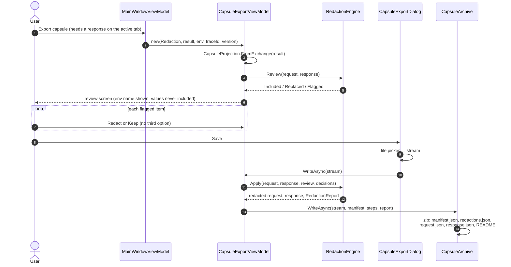

```text
CapsuleExportViewModel(engine, result, env, traceId, version):
    step    ← CapsuleProjection.FromExchange(result)
    review  ← engine.Review(step.Request, step.Response)
              // Included as-is · Replaced automatically (known secrets, patterns, field names)
              // · Flagged for a human decision (personal data and the like)
    Flagged ← review.Flagged as decision rows (undecided = redacted)

WriteAsync(stream):
    decisions ← flagged.Location → Keep
    (req, resp, report) ← engine.Apply(request, response, review, decisions)
    CapsuleArchive.WriteAsync(stream, manifest{title, env name, traceId, version, note},
                              [step(req, resp)], report)

courier capsule inspect FILE [--redactions]:
    capsule ← CapsuleArchive.ReadAsync(file);  print the manifest, steps and, if asked, redactions
```

**Key files**: `App/ViewModels/CapsuleExportViewModel.cs`, `App/Views/Dialogs/CapsuleExportDialog.axaml.cs`,
`Core/Capsules/RedactionEngine.cs`, `Core/Capsules/CapsuleArchive.cs`, `Cli/Commands/CapsuleCommand.cs`

---

## F13. CLI `courier run`

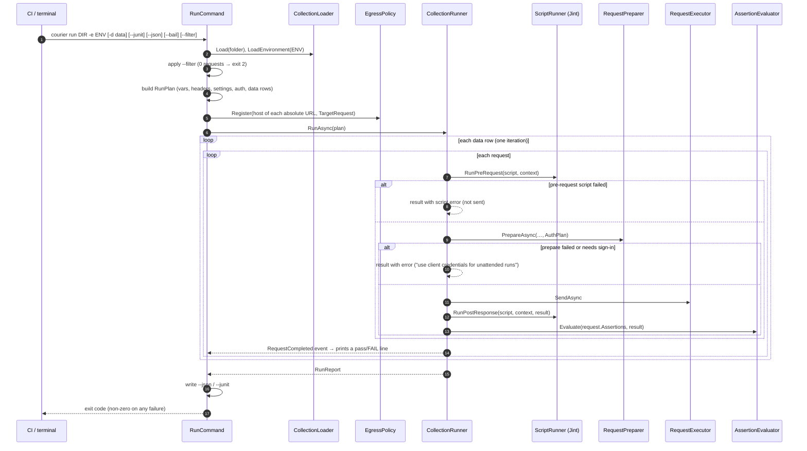

```text
RunCommand.ExecuteAsync(folder, env, data, json, junit, bail, filter):
    collection ← CollectionLoader.Load(folder)
    requests   ← filter ? where name/url contains filter : all
    if none → stderr; return 2
    environment ← env ? CollectionLoader.LoadEnvironment(folder, env) : null
    plan ← RunPlan{ requests, environment, Shared vars, collection vars/headers/settings,
                    Data = DataFileReader.Read(csv|tsv|json), StopOnFailure = bail,
                    CollectionAuth, AuthProfiles = AuthProfileStore.Load, AuthRegistry }
    for r in requests with an absolute URL: EgressPolicy.Register(uri, TargetRequest)
    report ← new CollectionRunner(Executor, Variables).RunAsync(plan)
    write report.ToJson() / report.ToJUnitXml() if asked
    return report.ExitCode

CollectionRunner.RunAsync(plan):
    rows ← plan.Data or [ {} ]                              // no data = one iteration
    for row: context ← { Environment, CollectionVariables, Variables = row }   // live dicts
        for request:
            pre ← ScriptRunner.RunPreRequest(request.Scripts.PreRequest, context)
            if pre failed → record error; continue (or stop if bail)
            scopes ← { Request = context.Variables, Environment = plan.Environment,
                       Collection = context.CollectionVariables, Global = context.Environment }
            prep ← RequestPreparer.PrepareAsync(…, AuthPlan(AuthResolver.Resolve(…)))
            if failed → record error (interactive sign-in explained for CI)
            result ← Executor.SendAsync(prep.Request)
            post   ← ScriptRunner.RunPostResponse(script, context, result)   // can set vars
            asserts ← AssertionEvaluator.Evaluate(request.Assertions, result)
            raise RequestCompleted
```

In the CLI, secrets come from `COURIER_SECRET_<SCOPE>_<NAME>` environment variables. The CLI's
secret store refuses writes on purpose.

**Key files**: `Cli/Commands/RunCommand.cs`, `Cli/Services/CliServices.cs`,
`Scripting/Running/CollectionRunner.cs`, `Scripting/Assertions/AssertionEvaluator.cs`

---

## F14. CLI `scan`, `export`, and the MSBuild task

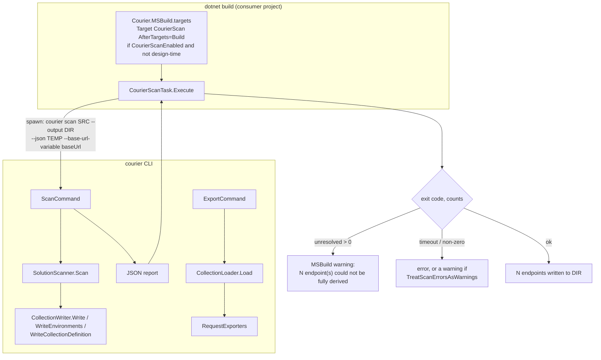

```text
CourierScanTask.Execute():
    if SourcePath missing → Report("nothing was scanned")
    run ToolPath "scan SRC --output DIR --json TEMP --base-url-variable VAR"
        (no window, redirected output, WorkingDirectory = SourcePath)
    if it doesn't exit within TimeoutSeconds → kill; Report(timeout)
    log stdout lines; if exit ≠ 0 → Report(stderr)
    ReadCounts(TEMP) → EndpointCount, UnresolvedCount
    if UnresolvedCount > 0 → LogWarning (shown in the IDE error list)

ScanCommand(path, --output, --json, --base-url-variable, --fail-on-unresolved):
    result ← SolutionScanner.Scan(path, cached hashes if --output has a cache)
    if --output: CollectionWriter.Write + WriteEnvironments (secret writes are reported, not thrown)
                 + WriteCollectionDefinition
    print a summary; write the JSON report; exit non-zero on unresolved if asked

ExportCommand(folder, --format curl|http|csharp|python, --request filter, --output):
    for request in CollectionLoader.Load(folder).Requests matching filter:
        emit RequestExporters.To{Curl|HttpFile|CSharp|Python}(request)
```

**Key files**: `MSBuild/CourierScanTask.cs`, `MSBuild/build/Courier.MSBuild.targets`,
`Cli/Commands/ScanCommand.cs`, `Cli/Commands/ExportCommand.cs`

---

## F15. Scripting sandbox

Scripts run only in `courier run` (through `CollectionRunner`). The desktop Send path doesn't run
scripts or evaluate assertions yet.

```mermaid
flowchart LR
    S["request.Scripts.PreRequest /<br/>PostResponse"] --> SR["ScriptRunner.Run"]
    SR --> SB["new ScriptSandbox per script<br/>(never shared)"]
    SB --> LIM["Jint options: Strict, TimeoutInterval,<br/>LimitMemory, MaxStatements,<br/>LimitRecursion, no CLR interop"]
    SB --> STRIP["remove globals that reach the host"]
    SR --> PM["PmApi: pm.environment, pm.variables,<br/>pm.collectionVariables, pm.globals,<br/>pm.response, pm.test, pm.expect"]
    PM -- "Expose('pm'), Expose('postman')" --> SB
    SB --> OUT["ScriptRun: Succeeded, Error,<br/>console, Unsupported pm.* calls, Tests"]
    PM -. "writes go to live dictionaries" .-> CTX["ScriptContext<br/>(visible to the next request)"]
```

```text
ScriptRunner.Run(script, context, result?):
    if script is blank → ScriptRun.NotRun
    sandbox ← new ScriptSandbox(limits)            // Default, or ForRunner in collection runs
    pm ← new PmApi(engine, result, context.Environment, context.Variables,
                   context.Globals, context.CollectionVariables, sandbox.UnsupportedCalls)
    sandbox.Expose("pm", pm);  sandbox.Expose("postman", pm)
    outcome ← sandbox.Run(script)                  // returns a result, never throws to the caller
    return ScriptRun(outcome.Succeeded, outcome.Error, outcome.Console,
                     outcome.Unsupported, pm.Results)
```

**Key files**: `Scripting/ScriptRunner.cs`, `Scripting/Sandbox/ScriptSandbox.cs`, `Scripting/Pm/PmApi.cs`,
`Scripting/Pm/PmExpectation.cs`

---

## F16. History

```mermaid
flowchart LR
    SEND["SendAsync completes"] --> REC["HistoryStore.RecordAsync(result, env,<br/>collection, requestId, SecretValues)"]
    REC --> RED["Redact(headers, SecretValues)<br/>(auth token never stored in plaintext)"]
    RED --> DB[("SQLite history table")]
    START["Startup job 'history'"] --> LOAD["LoadHistoryAsync → QueryAsync / CountAsync"]
    LOAD --> DB
    PANE["History pane / inspector 'this tab'"] --> Q["QueryAsync (filtered in SQL)"] --> DB
    Q --> PAY["GetPayloadAsync(id)"]
```

```text
HistoryStore.RecordAsync(result, env, collection, requestId, secretValues):
    secrets ← set(secretValues)
    INSERT history(started, method, url, path, status, outcome, elapsed, bytes,
                   env, collection, requestId, traceId, failureKind, failureMessage,
                   Redact(request.Headers, secrets), request.Body,
                   Redact(response.Headers, secrets), response.Body, response.BodyPath)
    return new row id
```

`PruneAsync(retention)` exists, but nothing in the app or CLI calls it yet.

**Key files**: `Core/Storage/HistoryStore.cs`, `Core/Storage/CourierDatabase.cs`,
`App/Views/HistoryPaneView.axaml`

---

## F17. Telemetry reconstruction (library only)

The libraries are implemented, but no menu, button or CLI command reaches them yet.
`TelemetryReconstructViewModel` and its dialog exist, but they aren't wired to these sources.

```mermaid
flowchart LR
    Q["search: trace id / route / time"] --> SRC{"ITelemetrySource"}
    SRC --> AI["AppInsightsSource<br/>(Azure.Monitor.Query)"]
    SRC --> DD["DatadogSource"]
    AI --> TR["TelemetryRequest"]
    DD --> TR
    TR --> RR["RequestReconstructor.Rebuild<br/>→ ReconstructedRequest<br/>(Missing list, Describe())"]
    RR -.-> TAB["would open as a tab (not wired)"]
    CAP["capsule"] -.-> ADO["WorkItemAttachmentClient<br/>attach to Azure DevOps (not wired)"]
    AI -. "EgressGate.CreateClient<br/>TelemetryBackend" .-> G{{"EgressGate"}}
    DD -.-> G
    ADO -. "WorkItemTracker" .-> G
```

```text
RequestReconstructor.Rebuild(telemetryRequest):
    method, url, headers, body (whatever the backend logged) → ReconstructedRequest
    Missing ← the parts the backend did not hold
    IsComplete ← Missing is empty;  Describe() explains the fidelity (TEL-05)
```

**Key files**: `Telemetry/ITelemetrySource.cs`, `Telemetry/AppInsights/AppInsightsSource.cs`,
`Telemetry/Datadog/DatadogSource.cs`, `Telemetry/Reconstruction/RequestReconstructor.cs`,
`Telemetry/AzureDevOps/WorkItemAttachmentClient.cs`

---

## 4. Implementation status

Checked against the code by looking for a caller in `Courier.App` or `Courier.Cli`, not taken
from the README.

| Area | Status | Reached from |
|---|---|---|
| Send request with variables, path params, query, headers | ✅ wired | App Send, `courier run` |
| Auth: request / collection / profile, Bearer, Basic, Entra (client credentials, auth code) | ✅ wired | App Send, Auth panel, Settings, `courier run` |
| "Get token" + JWT decode, failure popup | ✅ wired | Auth panel, profile editor |
| Auth providers ApiKey, AWS SigV4, Integrated Windows | ◐ library only | not in either `AuthProviderRegistry` |
| Egress gate (policy, records, handler selection) | ✅ wired | every send, every token call |
| Network statement report (`NetworkStatement.Render`) | ◐ view-model method, no UI caller yet | `MainWindowViewModel.RenderNetworkStatement` |
| Response rendering (Pretty / Raw formatted / Raw, search, 4 MB banner) | ✅ wired | response pane |
| Response Tests, Server, Preview tabs | ⛔ disabled with tooltip | — |
| Save / Save all / close guard | ✅ wired | Ctrl+S, Save button, menu, tab close |
| Tab suspension + session restore | ✅ wired | tab strip, startup job, window close |
| Import from code (controllers, minimal APIs, DTO sample bodies, environments, Postman env exports) | ✅ wired | menu, palette, first-run, `courier scan`, MSBuild |
| Semantic scan tier (`DtoSampleGenerator`, MSBuildWorkspace) | ◐ library only | — |
| Generated/overlay join | ✅ wired | every collection load |
| Environments editor + local secrets | ✅ wired (no rename/delete of a whole environment) | Settings, title-bar picker |
| curl import/export; http/C#/Python export | ✅ wired (curl in app; all four in CLI) | URL box, menu, `courier export` |
| Capsule export / inspect | ✅ export in app, inspect in CLI | response toolbar, `courier capsule inspect` |
| Scripts + assertions | ◐ CLI only | `courier run` |
| History record/query | ✅ wired; prune not called | Send, history pane |
| Postman collection importer | ◐ library only | — |
| Telemetry sources, reconstruction, Azure DevOps | ◐ library only | — |
| OpenAPI import | ⛔ not built | — |
